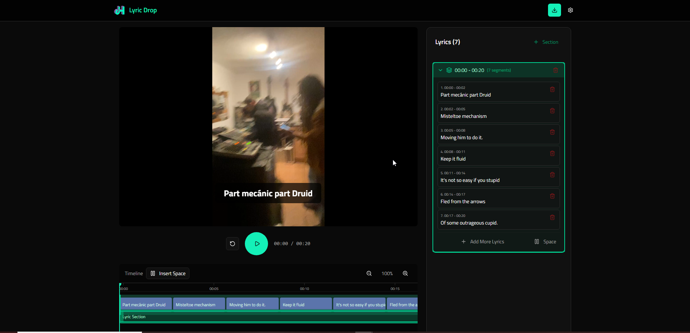

# 🎤 Lyric Drop



> Add synchronized lyrics to short-form videos for TikTok, Instagram Reels, and YouTube Shorts — no video editing experience required.

[](https://react.dev/)
[](https://www.typescriptlang.org/)
[](https://vite.dev/)
[](https://tailwindcss.com/)
[](https://opensource.org/licenses/MIT)

---

## ✨ Features

- **📋 Bulk Lyric Import** — Paste entire song lyrics at once, no manual line-by-line entry
- **⏱️ Visual Timeline Editor** — Drag-and-drop lyric segments with precision timing
- **🎬 Real-Time Preview** — See lyrics overlaid on your video as you edit
- **📱 Mobile-First Design** — Works seamlessly on phones, tablets, and desktop
- **🎥 Multi-Format Support** — Upload MP4, MOV, WebM, AVI and more
- **⚡ Auto-Distribution** — Automatically spread lyrics evenly across video duration
- **💾 Direct Export** — Download your finished video with burned-in subtitles

---

## 🚀 Quick Start

```bash
# Clone the repository
git clone https://github.com/joehunterdev/lyric-drop.git
cd lyric-drop/client

# Install dependencies
npm install

# Start development server
npm run dev
```

Open [http://localhost:8081](http://localhost:8081) in your browser.

---

## 📖 How It Works

1. **Upload** your video (MP4, MOV, or other supported formats)
2. **Paste** your full lyrics into the editor
3. **Adjust** timing on the visual timeline
4. **Preview** your video with Lyric Drops
5. **Export** and share on your favorite platform

---

## 🛠️ Tech Stack

| Layer | Technology |
|-------|------------|
| **Frontend** | React 19, TypeScript, Vite 7 |
| **Styling** | Tailwind CSS 4, shadcn/ui |
| **Video Processing** | FFmpeg (WASM / Server-side) |
| **State Management** | React Hooks |

---

## 📁 Project Structure

```text
client/
├── src/
│   ├── components/
│   │   ├── VideoPlayer/      # Video playback & preview
│   │   ├── Timeline/         # Visual timeline editor
│   │   ├── LyricEditor/      # Lyric input & management
│   │   └── ExportButton/     # Video export with overlays
│   ├── hooks/                # Custom React hooks
│   ├── types/                # TypeScript interfaces
│   └── utils/                # Helper functions
└── ...
```

---

## 🎯 Use Cases

- **Musicians** — Add lyrics to music videos and promotional clips
- **Content Creators** — Create karaoke-style videos for social media
- **Podcasters** — Highlight key quotes in video snippets
- **Marketers** — Add captions and text overlays to ads

---

## 🗺️ Roadmap

- [x] Video upload and playback
- [x] Bulk lyric import
- [x] Timeline-based segment editing
- [x] Real-time lyric preview
- [x] Video export with overlays
- [ ] Custom fonts and text styling
- [ ] Animation effects for lyrics
- [ ] Waveform visualization
- [ ] Project save/load

---

## 🤝 Contributing

Contributions are welcome! Please feel free to submit a Pull Request.

1. Fork the repository
2. Create your feature branch (`git checkout -b feature/amazing-feature`)
3. Commit your changes (`git commit -m 'Add amazing feature'`)
4. Push to the branch (`git push origin feature/amazing-feature`)
5. Open a Pull Request

---

## 📄 License

This project is licensed under the MIT License - see the [LICENSE](LICENSE) file for details.

---

## 👤 Author

### Joe Hunter

- GitHub: [@joehunterdev](https://github.com/joehunterdev)
- Website: [joehunter.es](https://joehunter.es)

---

## ⭐ Support

If you find this project useful, please consider giving it a star on GitHub!

---

Made with ❤️ for content creators everywhere
